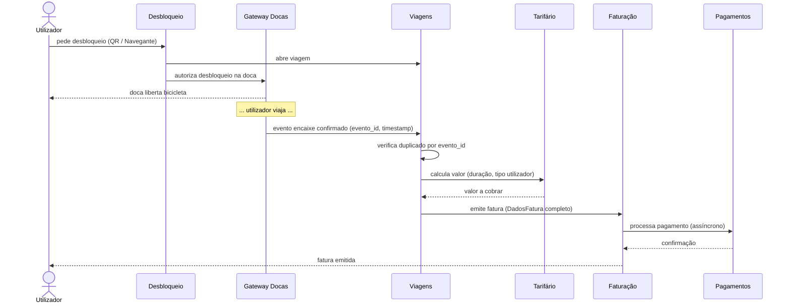
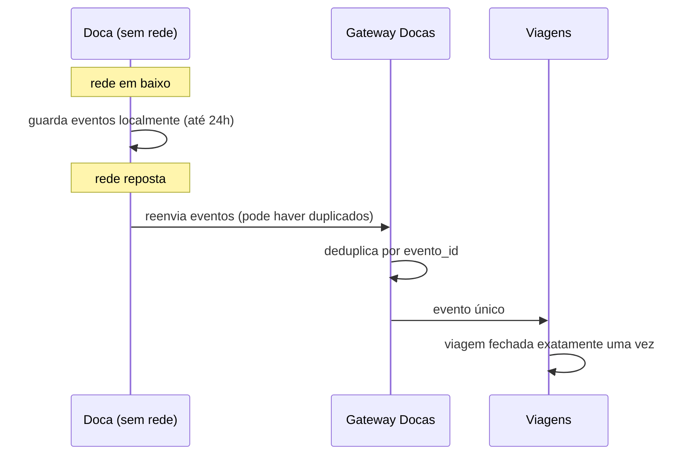

# Particionamento e Vistas

## 1. Particionamento de topo

**Escolha: particionamento por domínio (monólito modular)**

Os componentes são agrupados por domínio de negócio, não por
camada técnica (controllers, services, repositories). Cada
domínio vive num pacote Python independente com fronteiras
explícitas impostas por fitness functions.

**Trade-off:**

- **Vantagem sobre técnico:** uma mudança de negócio (ex: novo
  tarifário) toca um único pacote. As fronteiras de domínio
  são visíveis na estrutura de pastas. Com 6 pessoas, cada
  uma pode ser dona de um domínio inteiro.

- **Desvantagem:** sem fitness functions, o acoplamento entre
  domínios cresce silenciosamente. Escalabilidade independente
  por componente é impossível sem re-arquitectar.

- **Porque não técnico:** mudanças de negócio atravessariam
  sempre múltiplas camadas (controller → service → repo),
  multiplicando a coordenação entre pessoas para cada feature.

- **Porque não microserviços:** 6 pessoas e orçamento fixo
  tornam inviável operar múltiplos deploys, pipelines e
  contratos de API entre serviços.

**Exceção:** o Gateway de Docas corre como processo separado
porque é o ponto crítico de disponibilidade (ver ADR-002).

## 2. Vista de módulos

### Estrutura de pacotes

lisboa_pedala/
desbloqueio/
gateway_docas/
viagens/
tarifario/
faturacao/
pagamentos/
disponibilidade/
manutencao/
redistribuicao/
relatorios/
shared/ # tipos partilhados: DuracaoMinutos, DadosFatura

### Regras allowed-to-use

Escritas como regras verificáveis por import-linter:

| Componente | Pode importar de |
|---|---|
| desbloqueio | viagens, disponibilidade, shared |
| gateway_docas | viagens, disponibilidade, manutencao, shared |
| viagens | tarifario, faturacao, shared |
| tarifario | shared |
| faturacao | pagamentos, shared |
| pagamentos | shared |
| disponibilidade | shared |
| manutencao | shared |
| redistribuicao | disponibilidade, shared |
| relatorios | viagens, shared |

**Regras proibidas:**
- Qualquer importação fora da lista acima é uma violação.
- Nenhum componente pode criar um ciclo de dependência.
- Nenhum componente pode importar de `gateway_docas`
  (só recebe eventos, nunca é chamado diretamente).

## 3. Vista de componentes e conectores

### Fluxo desbloquear → devolver → cobrar

### Fluxo offline — US-3

## 4. Vista de alocação

### Onde corre cada parte

| Componente | Processo | Notas |
|---|---|---|
| Desbloqueio | principal (API REST) | |
| Viagens | principal (API REST) | |
| Tarifário | principal (interno) | sem endpoint próprio |
| Faturação | principal (interno) | |
| Pagamentos | principal (simulado) | |
| Disponibilidade | principal (API REST) | |
| Manutenção | principal (API REST) | |
| Redistribuição | principal (API REST) | |
| Relatórios | principal (API REST) | |
| Gateway de Docas | processo separado | ver ADR-002 |

**Persistência:** SQLite (ver ADR-005)

**Responsabilidade:** todo o repositório — Marco (trabalho
individual; ver CODEOWNERS)

### Referência aos diagramas C4

- Contexto (nível 1): `docs/diagramas/c4-contexto.md`
- Contentores (nível 2): `docs/diagramas/c4-contentores.md`
- Componentes (nível 3): `docs/diagramas/c4-componentes.md`

