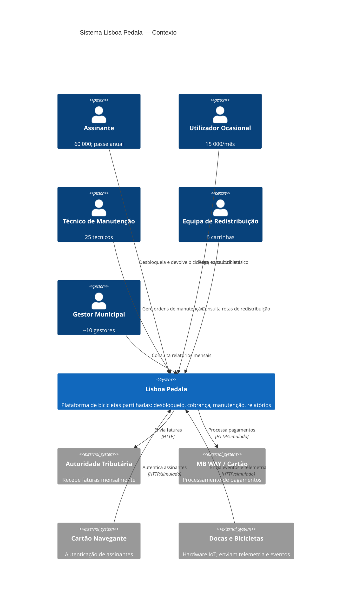

# C4 Nível 1 — Contexto

## Legenda

| Elemento | Descrição |
|---|---|
| 🧍 Pessoa (azul) | Utilizador humano do sistema |
| ▭ Sistema (azul escuro) | O sistema Lisboa Pedala |
| ▭ Sistema externo (cinzento) | Sistema fora do âmbito da solução |
| → Relação | Interação entre elementos; etiqueta indica protocolo |